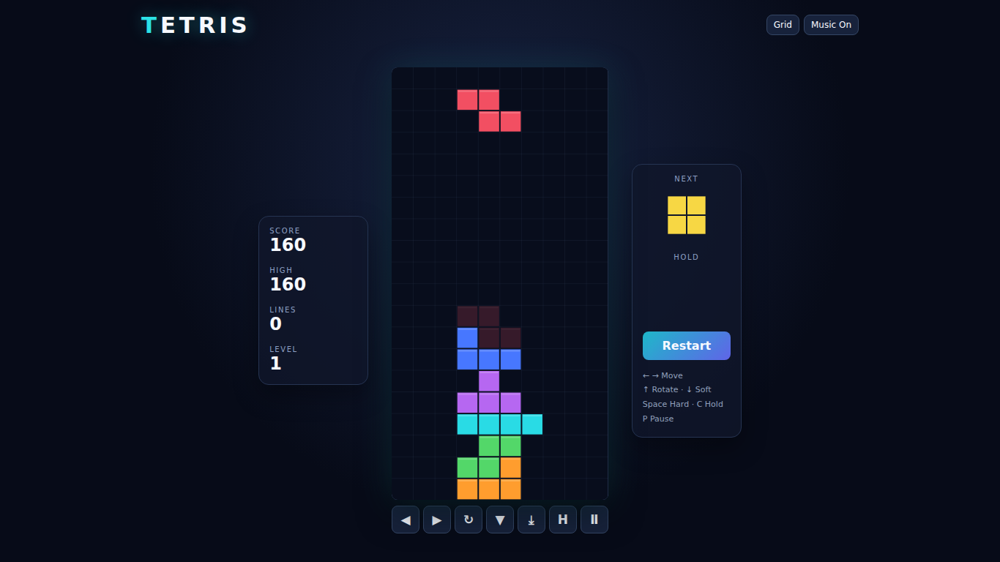

# Tetris

**Play now: https://nateofspades.github.io/tetris_game/**



A responsive, dependency-free Canvas Tetris implementation with a separately tested game engine. It includes seven-bag randomization, SRS-style wall kicks, ghost and hold pieces, scoring, levels, local high scores, optional grid and sound, keyboard controls, and touch controls.

## Controls

| Action | Keyboard | Touch |
|---|---|---|
| Move | Left / Right arrows | ◀ / ▶ |
| Rotate | Up arrow | ↻ |
| Soft drop | Down arrow | ▼ |
| Hard drop | Space | ⤓ |
| Hold | C or Shift | H |
| Pause | P or Escape | Ⅱ |

## Development

```bash
npm install
npm run dev       # http://127.0.0.1:4175
npm test          # Vitest engine tests
npm run build     # production bundle
npm run test:e2e  # Playwright browser tests
npm run test:all  # everything
```

Playwright tests use deterministic `?seed=` fixtures and validate six target viewport sizes.
