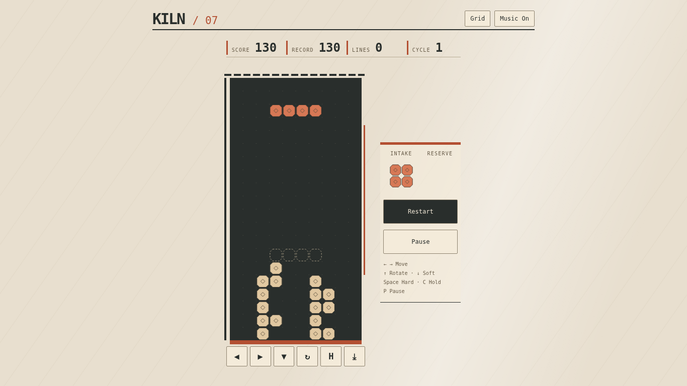

# Kiln / 07 — private working title

Existing public build (unchanged older presentation): https://nateofspades.github.io/tetris_game/



Real Playwright capture of the running local branch, not a mockup or the public deployment. [Small-mobile gameplay capture](assets/screenshots/private-gameplay-mobile.png).

A local presentation study of the existing falling-block game, **not a new public release**. The proposed migration name **Neon Stack** is documented in [private migration preparation](docs/private-migration.md); neither that name nor a new public URL is cleared or verified.

The ceramic-workshop direction replaces the previous neon/rainbow presentation with an open asymmetric gantry, registration-point bed, matte chamfered tiles, a warm mineral palette, production readout rail and intake/reserve instrument panel. These expressive changes do **not** resolve legal questions about the retained gameplay combination. Public deployment remains on hold.

## Preserved gameplay

The existing engine retains its 10×20 playable board, exact seven four-cell pieces, seven-bag randomization, SRS-style rotations/kicks, landing guide, hold, soft/hard drops, scoring, levels and local high score. No rules rewrite or recreated game is intended.

| Action | Keyboard | On-screen control |
|---|---|---|
| Move | Left / Right | ◀ / ▶ |
| Rotate | Up | ↻ |
| Soft drop | Down | ▼ |
| Hard drop | Space | ⤓ |
| Hold | C or Shift | H |
| Pause / resume | P or Escape | Pause, then Resume overlay |
| Restart | — | Restart |
| Grid | — | Grid (hidden in compact landscape) |
| Music | — | Music On / Off |

## Music and persistence

The existing track **Neon Stack** and entire `src/music.js` are preserved byte-for-byte from baseline `842622f6200e3a55847a7cda5699332b86190653`. It uses locally synthesized square/triangle/noise audio, with no bundled third-party recording/sample. The source's originality statement is not independent musicological verification or a license grant.

Music defaults on but starts only after interaction. Pause/visibility handling suspends the existing audio context; resume continues its source. Restart, game over and resize do not recreate the track. Legacy keys `tetris-high-score` and `tetris-music` remain for compatibility. A move to another origin would require separate migration; localStorage does not follow automatically.

## Local setup and checks

Requires compatible Node.js (22+ recommended).

```sh
npm ci
npx playwright install chromium
npm run dev       # http://127.0.0.1:4175
npm test          # full Vitest suite
npm run build
npm run test:e2e  # Chromium, one worker; starts its own local Vite server
npm run test:all
```

In the shared audit environment, wrap all test/build/browser/server commands with `flock /root/arcade-migration-audit/preparation/test.lock`; do not leave a separate server running. Dependencies in that environment are symlinked to the original checkout and are not committed.

The browser suite exercises 1920×1080, 1366×768, 768×1024, 390×844, 320×568, 844×390 and the additional short-landscape 568×320 case. It checks no-scroll/full-board geometry, actual bottom-row lock/render/clear, whole-toggle hit targets, keyboard/touch play, orientation, restart, music source continuity and legacy records. The current desktop and small-mobile gameplay captures above are committed with this private branch. Additional viewport screenshots and raw execution logs remain in the external preparation directory. The older tracked screenshot is historical, not evidence of the current design.

## Release limitations

No general repository license was identified; ownership/authorization still needs documentation. Exact seven-piece family, board proportions, line clearing, rotations/kicks, ghost/hold/next and their overall combination remain recognizable and require qualified comparative review. A changed title, palette or framing is not legal clearance. No trademark search, public deployment, repository rename, push, merge or public URL validation is included. See [migration gates](docs/private-migration.md).

## Technology and third-party credits

Vanilla JavaScript ES modules, Canvas 2D, CSS responsive layout and Web Audio; Vite build tooling, Vitest unit testing and Playwright browser testing. The installed Vite and Vitest tooling is MIT-licensed; Playwright Test uses Apache-2.0. Their actual installed copyright, license and NOTICE texts are retained in [third-party tooling notices](docs/THIRD_PARTY_NOTICES.md). Keep applicable notices with redistributed generated helper code/builds. These tooling licenses do not establish ownership or permission for unrelated game-specific inputs. No downloaded commercial game sprites, fonts or sampled soundtrack were introduced by this preparation.
